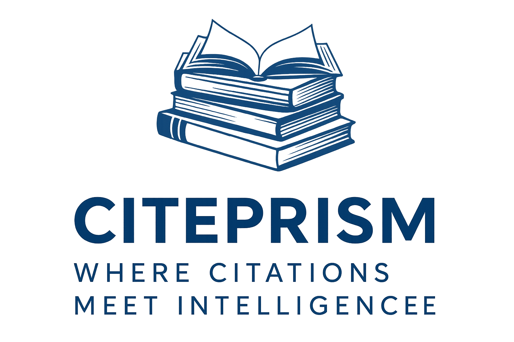
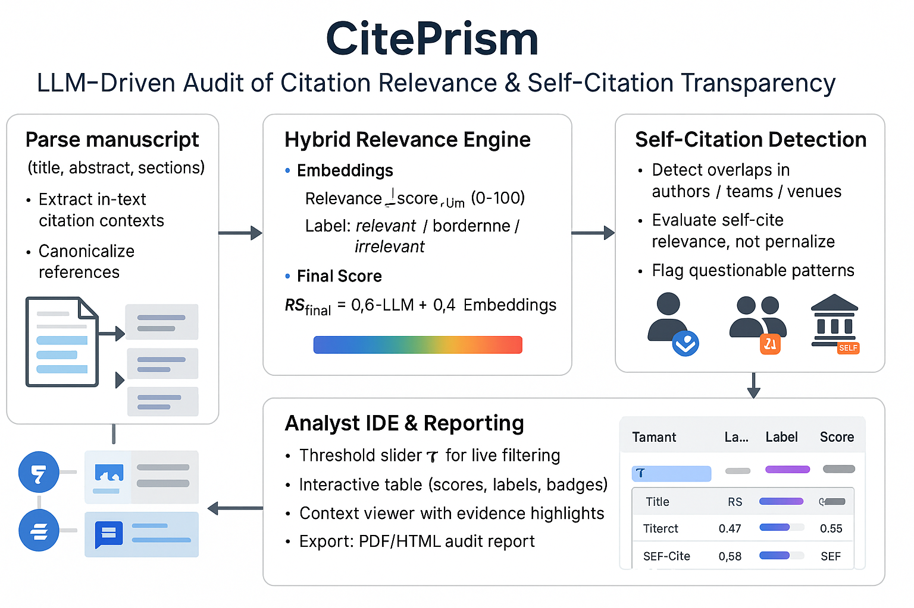
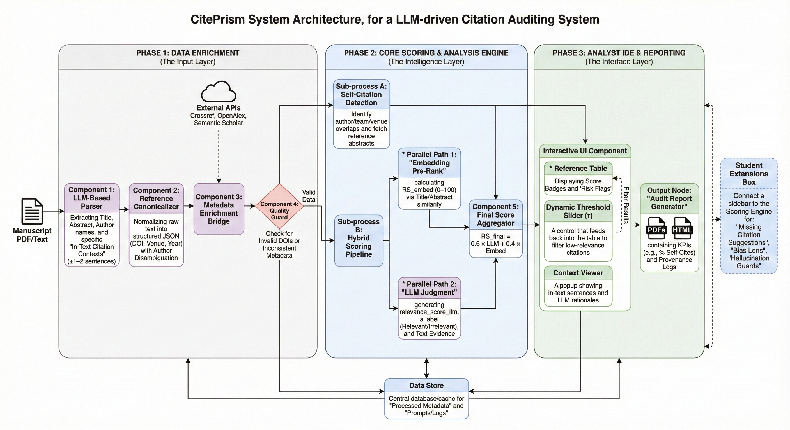

# CitePrism — AI-Powered Academic Citation Evidence Assurance

<p align="center">
  
</p>

<p align="center">
  <strong>AI-Assisted Academic Citation Auditing & Human Review Platform</strong>
</p>

<p align="center">
  <strong>Python · FastAPI · React · TypeScript · Gemini · Hugging Face · NLP</strong>
</p>

<p align="center">
  <strong>Current Version: Phase 4 — Enterprise Runtime & Evidence Assurance</strong>
</p>

---

## 🔍 Overview

**CitePrism** is an AI-powered academic citation auditing system designed to help researchers, reviewers, and academic institutions examine the reliability, relevance, and traceability of references in research manuscripts.

The platform combines Natural Language Processing (NLP), Large Language Models (LLMs), scholarly metadata retrieval, semantic similarity, and evidence-grounded assessment to support academic citation review.

CitePrism was originally developed as an M.Sc. Applied Data Science case study and has evolved into a collaborative evidence-assurance platform.

The project focuses on:

- **Academic Manuscript Parsing**
- **Bibliography and In-Text Citation Extraction**
- **Scholarly Source Identification**
- **Citation Relevance Assessment**
- **Metadata Verification**
- **Evidence-Grounded AI Analysis**
- **Human-Supervised Citation Review**
- **Self-Citation Transparency**
- **Audit Trails and Provenance**
- **Exportable Citation Review Reports**

The goal is to help reviewers identify references that require further investigation while preserving transparency, traceability, and human oversight.

> **Responsible AI Principle:** CitePrism produces automated review findings and evidence-based proposals, not final judgments of citation error, bias, research quality, or academic misconduct. Every finding requires appropriate human interpretation.

---

## 📊 Project Graphical Abstract

<p align="center">
  
</p>

---

## 🏗️ Project Architecture

<p align="center">
  
</p>

The original project architecture illustrates the development of the citation-analysis pipeline.

The current Phase 4 architecture extends this foundation with a React reviewer workspace, FastAPI backend, persistent audit jobs, evidence acquisition, human-review workflows, and optional durable infrastructure.

### Phase 4 Architecture


The current application follows this workflow:

```text
                  USER / RESEARCHER
                         |
                         v
                Upload Research PDF
                         |
                         v
                  React Frontend
                         |
                         v
                    FastAPI
                         |
                         v
                 Audit Job Created
                         |
                         v
                 Python Pipeline
                         |
          +--------------+--------------+
          |              |              |
          v              v              v
       Parsing       Reference       Citation
                     Resolution      Assessment
          |              |              |
          +--------------+--------------+
                         |
                         v
                Evidence Validation
                         |
                         v
                  Review Findings
                         |
                         v
                 Human Reviewer
                         |
                         v
              Review Report / Export
```

---

# 🚀 How CitePrism Works

CitePrism analyses an uploaded academic manuscript and investigates the references used within it.

The complete workflow is explained below.

## Step 1 — Manuscript Upload

A researcher uploads an academic PDF through the CitePrism web interface.

The system registers the manuscript and prepares it for processing.

The uploaded document is preserved as part of the audit evidence.

## Step 2 — Document Parsing

CitePrism uses its document-processing pipeline and configured LLM provider to extract structured information from the uploaded manuscript.

Extracted information includes:

- Manuscript title
- Authors
- Bibliography entries
- In-text citation markers
- Citation contexts
- Citation locations

For example:

> "Artificial intelligence improves medical diagnosis accuracy [5]."

CitePrism identifies citation `[5]` and attempts to connect it with the corresponding bibliography entry.

## Step 3 — Reference Identification

After extracting the bibliography, CitePrism attempts to identify the real scholarly publications referenced by the manuscript.

It uses external scholarly databases including:

- OpenAlex
- Crossref
- Semantic Scholar

The system compares available bibliographic information such as:

- Publication title
- Author names
- Publication year
- DOI

If a reliable publication identity cannot be established, CitePrism marks the reference as unresolved rather than silently selecting an uncertain match.

## Step 4 — Metadata Enrichment

Once a publication is identified, CitePrism retrieves available scholarly metadata.

This may include:

- Publication title
- Authors
- DOI
- Publication year
- Journal or venue
- Abstract
- Available source information

CitePrism does not require a local database containing millions of academic papers.

Instead, it searches external scholarly services and stores the evidence associated with each audit.

## Step 5 — Citation Relevance Assessment

CitePrism evaluates the relationship between the text surrounding a citation and the available evidence from the cited publication.

For example:

**Manuscript claim:**

> "The proposed model improves classification accuracy by 30%."

**Retrieved source evidence:**

> "The model achieved an 8% improvement in classification accuracy."

CitePrism may identify the difference as requiring further investigation.

However, the system does not automatically conclude that the manuscript is incorrect. Different datasets, experiments, metrics, or publication versions may explain the difference.

## Step 6 — Evidence Grounding

CitePrism validates AI-generated evidence proposals against the retrieved source evidence.

If a model produces a quotation, the system checks whether that quotation can be located in the stored source snapshot.

This helps identify unsupported or potentially hallucinated model-generated evidence.

A successfully located quotation establishes attribution to the stored evidence, not necessarily the scientific correctness of the interpretation.

## Step 7 — Human Review

CitePrism generates review findings based on the available evidence.

A reviewer can:

- Inspect the original bibliography entry
- Examine retrieved source metadata
- Review citation contexts
- Investigate model-generated proposals
- Confirm a review item
- Dismiss a review item
- Request additional evidence
- Escalate an issue
- Propose bibliography corrections

Human reviewers remain responsible for interpreting the results.

---

# 🧠 Technology Stack

| Technology | Purpose |
|---|---|
| Python 3.12 | Core backend and citation-processing pipeline |
| FastAPI | Backend REST API |
| React | Reviewer interface |
| TypeScript | Frontend development |
| Google Gemini | LLM-assisted parsing and assessment |
| Hugging Face | LLM-based relevance scoring |
| Sentence Transformers | Semantic text embeddings |
| Cosine Similarity | Text similarity measurement |
| OpenAlex | Scholarly metadata retrieval |
| Crossref | Publication and DOI metadata |
| Semantic Scholar | Additional source resolution |
| SQLite | Default local workspace database |
| PostgreSQL | Optional durable database |
| MinIO | Optional S3-compatible object storage |
| Docker | Optional containerized infrastructure |
| Git & GitHub | Version control and collaboration |

---

# ✨ Core Features

## 1. Citation Extraction

CitePrism extracts bibliography entries and in-text citations from uploaded academic manuscripts.

It links citation occurrences with bibliography entries where possible.

## 2. Reference Resolution

The system searches scholarly databases to identify the publications cited in a manuscript.

Uncertain matches are preserved for human review.

## 3. Metadata Verification

CitePrism compares the bibliography information submitted by the author against available external publication records.

Examples of findings include:

- Publication-year mismatch
- Unresolved source identity
- Missing DOI
- Incomplete bibliography metadata

## 4. Citation Relevance Assessment

The system evaluates whether the available source evidence appears related to the manuscript's citation context.

Automated assessments remain proposals for human review.

## 5. Evidence-Grounded Analysis

CitePrism checks whether model-generated quotations can be located in the stored source evidence.

This supports more transparent and traceable AI-assisted assessment.

## 6. Human Review Workspace

The system presents review findings through a React-based reviewer interface.

Reviewers can examine evidence and record decisions with rationales.

## 7. Bibliography Correction Proposals

Reviewers can suggest corrections to bibliographic information without modifying the original submitted manuscript.

## 8. Repair Workflows

System-related processing failures can be investigated and retried.

Repairs create new audit runs rather than overwriting existing audit evidence.

## 9. Audit History and Provenance

CitePrism records audit events and reviewer actions to support traceability.

## 10. Exportable Reports

The system supports review outputs including:

- PDF
- HTML
- JSON
- Signed review bundles

---

# 🖥️ Phase 4 Reviewer Workspace

The current application uses a React and TypeScript frontend connected to a FastAPI backend.

The main reviewer interface is available at:

**http://127.0.0.1:5173**

The interface contains eight main sections.

| Tab | Purpose |
|---|---|
| Queue | Review citation-related findings |
| Evidence | Inspect manuscript and source evidence |
| Repairs | Investigate and retry processing failures |
| Insights | Explore additional citation analyses |
| Exports | Generate review reports |
| Operations | Monitor audit jobs and system performance |
| Team | Manage reviewer assignments |
| Activity | View audit and review history |

### Queue

Displays findings that require human attention.

Examples include unresolved source identities, metadata mismatches, missing source text, and citation-evidence concerns.

### Evidence

Displays manuscript evidence alongside independently retrieved source information.

### Repairs

Allows targeted reprocessing of system-related issues.

### Insights

Provides additional analyses such as literature-search candidates and descriptive author-overlap information.

### Exports

Generates portable review reports and signed review packages.

### Operations

Displays audit jobs, queue status, latency, provider usage, and other operational information.

### Team

Supports reviewer assignment and workload visibility.

### Activity

Records operational events and human-review actions.

---

# 💻 Getting Started — Complete Windows Setup

This section explains how a new team member can clone and run CitePrism on their own computer.

**Follow the steps in order.**

## Step 1 — Install Prerequisites

Install the following software:

| Software | Required Version |
|---|---|
| Python | 3.12.x |
| Node.js | 20 or newer |
| npm | Installed with Node.js |
| Git | Recent version |
| Visual Studio Code | Recommended |

Download links:

- Python: https://www.python.org/downloads/
- Node.js: https://nodejs.org/
- Git: https://git-scm.com/
- VS Code: https://code.visualstudio.com/

During Python installation, select:

**Add python.exe to PATH**

The current project requires Python 3.12. Do not substitute Python 3.13 or newer without validating dependency compatibility.

### Verify Installation

After installation, completely close and reopen PowerShell or VS Code.

Run:

```powershell
py -3.12 --version
```

Expected:

```text
Python 3.12.x
```

Run:

```powershell
node --version
```

Expected:

```text
v20.x.x or newer
```

Run:

```powershell
npm --version
```

Run:

```powershell
git --version
```

All commands should return version numbers.

If Node.js or npm is not recognized, restart VS Code completely.

---

## Step 2 — Clone the Repository

Repository:

https://github.com/janvimahapadi-hub/CitePrism

If the repository is private, request access from the repository owner and accept the GitHub invitation before cloning.

Open PowerShell.

Navigate to the directory where you want to store the project:

```powershell
cd "$env:USERPROFILE"
```

Clone the repository:

```powershell
git clone https://github.com/janvimahapadi-hub/CitePrism.git
```

Enter the project folder:

```powershell
cd CitePrism
```

Your terminal should now be inside the folder containing the CitePrism source code.

**Important:** Git automatically creates the project folder. Do not manually create another `CitePrism` folder inside it.

If a folder named `CitePrism` already exists, check its contents before cloning into or replacing it.

---

## Step 3 — Verify the Project Directory

Run:

```powershell
Test-Path .\pipeline_orchestrator.py
```

Expected:

```text
True
```

Check the setup script:

```powershell
Test-Path .\scripts\setup_phase4.ps1
```

Check the environment template:

```powershell
Test-Path .\env.example
```

Check the frontend:

```powershell
Test-Path .\web\package.json
```

All four commands should return:

```text
True
```

If any command returns False, verify that you are inside the correct project directory.

---

## Step 4 — Open CitePrism in VS Code

From the project directory, run:

```powershell
code .
```

Alternatively:

1. Open VS Code.
2. Select File → Open Folder.
3. Select the CitePrism project directory.
4. Open Terminal → New Terminal.

Ensure that the terminal is in the folder containing `pipeline_orchestrator.py`.

---

## Step 5 — Allow PowerShell Scripts

Run:

```powershell
Set-ExecutionPolicy -Scope CurrentUser -ExecutionPolicy RemoteSigned
```

If PowerShell asks for confirmation, enter:

```text
Y
```

Press Enter.

If the computer is managed by a university or company and the policy change is restricted, follow the administrator's instructions.

---

## Step 6 — Install Project Dependencies

Run:

```powershell
.\scripts\setup_phase4.ps1 -GenerateSigningKey
```

This script automatically:

1. Creates the `.venv-phase4` Python virtual environment.
2. Installs Python dependencies.
3. Installs React/npm dependencies.
4. Creates `.env` from `env.example` if `.env` does not already exist.
5. Generates a machine-local export-signing key.

The installation may take several minutes.

Wait until it finishes.

Expected message:

```text
Phase 4 setup finished.
```

Do not close the terminal while packages are installing.

---

## Step 7 — Verify Generated Files

Run:

```powershell
Test-Path .\.env, .\.venv-phase4\Scripts\python.exe, .\secrets\export-signing.key
```

Expected:

```text
True
True
True
```

If any result is False, verify that setup completed successfully and that you are in the correct directory.

---

# 🔑 Environment Configuration

Each developer must configure their own local `.env` file.

The `.env` file contains configuration settings and private credentials.

It is intentionally excluded from GitHub.

Open it using:

```powershell
notepad .env
```

Or open `.env` directly in VS Code.

## 1. Google Gemini

Configure:

```ini
LLM_PROVIDER="google"

GOOGLE_API_KEY="YOUR_OWN_GOOGLE_API_KEY"

GOOGLE_MODEL="gemini-2.5-flash"
```

The model shown above is the default in the Phase 4 handoff template. Confirm that it is available to your Google API key and account.

Obtain a Google API key from:

https://aistudio.google.com/

## 2. Hugging Face

Configure:

```ini
HF_API_TOKEN="YOUR_OWN_HF_TOKEN"

HF_MODEL="meta-llama/Llama-3.1-8B-Instruct"
```

Create a token at:

https://huggingface.co/settings/tokens

The selected model may require the appropriate access and inference permissions.

## 3. OpenAlex

Configure:

```ini
OPENALEX_EMAIL="YOUR_OWN_EMAIL_ADDRESS"
```

Use your own email address.

The email identifies the API caller. It is not a password.

An additional OpenAlex API key may be needed depending on the access requirements of the configured service.

## 4. Optional API Credentials

CitePrism also contains optional configuration for:

- OpenAI
- Semantic Scholar
- Crossref
- Elsevier
- Springer

Do not share private keys between developers.

Only configure optional providers needed for your workflow.

## 5. Export Signing Key

Find:

```ini
CITEPRISM_EXPORT_SIGNING_KEY
```

Set:

```ini
CITEPRISM_EXPORT_SIGNING_KEY=secrets/export-signing.key
```

Each developer should use the signing key generated on their own machine.

Never share private signing keys.

## 6. Local Runtime Configuration

For the default single-workstation setup, use:

```ini
CITEPRISM_WORKSPACE_BACKEND=sqlite

CITEPRISM_OBJECT_BACKEND=local

CITEPRISM_AUTH_MODE=local

CITEPRISM_RUN_EMBEDDED_WORKER=true
```

These settings allow CitePrism to run locally without Docker.

Keep the other Phase 4 settings supplied by `env.example`.

Save the file before continuing.

> **Security:** Never commit `.env`, private signing keys, API credentials, uploaded manuscripts, or local databases to GitHub.

---

# ✅ Verify the Installation

Run:

```powershell
.\scripts\verify_phase4.ps1 -Python .\.venv-phase4\Scripts\python.exe
```

This runs the Phase 4 verification checks, including the Python tests and frontend build.

Expected final message:

```text
Phase 4 verification passed.
```

You may also see:

```text
PostgreSQL workspace tests were skipped.
```

This is expected when Docker/PostgreSQL is not enabled.

If verification fails, inspect the specific error before continuing.

---

# ▶️ Start CitePrism

Run:

```powershell
.\scripts\start_phase4.ps1 -Python .\.venv-phase4\Scripts\python.exe
```

This starts the backend and frontend.

Keep the terminal running.

### Reviewer Website

http://127.0.0.1:5173

### FastAPI Documentation

http://127.0.0.1:8000/api/docs

Press `Ctrl + C` in the running terminal to stop CitePrism.

---

# 📅 Daily Usage

After the initial installation, you do not need to reinstall dependencies every time.

Open VS Code and the CitePrism project folder.

Run:

```powershell
.\scripts\start_phase4.ps1 -Python .\.venv-phase4\Scripts\python.exe
```

If your terminal is not already inside the project folder, navigate to your actual clone location first.

For example:

```powershell
cd "$env:USERPROFILE\CitePrism"
```

Docker is not required for the default local setup.

---

# 🐳 Docker and Database Configuration

CitePrism supports two runtime profiles.

## Default Local Runtime

The default development environment uses:

```text
React Frontend
      |
      v
FastAPI Backend
      |
      v
Python Pipeline
      |
      v
SQLite Database
      +
Local File Storage
```

This is intended for development on a trusted workstation.

No Docker installation is required.

## Optional Durable Runtime

Phase 4 additionally supports:

- PostgreSQL
- S3-compatible object storage
- MinIO
- Separate worker processes
- Durable audit jobs
- Multi-user infrastructure

Docker helps run PostgreSQL and MinIO consistently across development machines.

The optional services can be started using:

```powershell
docker compose -f compose.phase4.yml up -d workspace-db objects provision
```

The database, object-storage, and worker configuration must then be updated according to:

[Phase 4 Enterprise Runtime](docs/PHASE_4_ENTERPRISE_RUNTIME.md)

The Docker Compose credentials supplied for local development must not be reused for a production deployment.

**Docker is optional for normal local CitePrism development.**

---

# 🔬 Running Your First Audit

After starting CitePrism:

1. Open the reviewer interface.
2. Select New Manuscript.
3. Upload an academic research PDF.
4. Start an audit.
5. Wait for the analysis to complete.
6. Open Queue to examine the findings.
7. Open Evidence to investigate individual references.
8. Record reviewer decisions where appropriate.

For the first test, use a small, text-based research PDF.

A successful website startup does not automatically prove that every external AI and scholarly API is available.

A complete audit is the functional test of the configured workflow.

---

# 🚀 Recent Improvements

CitePrism has evolved through multiple development phases to improve reliability, transparency, scalability, and the academic review experience.

The following improvements were introduced in earlier versions and remain part of the project's development history.

## Phase 0 / CitePrism V2 Improvements

### 1. Cached SentenceTransformer Model Loading

Reduced repeated embedding-model loading and improved scoring speed after the first load.

### 2. Optional Missing Citation Generation

Added Fast Audit and Full Audit modes to allow users to skip expensive missing-citation suggestions during routine audits.

### 3. Runtime Metrics

Added processing-time measurements for parsing, enrichment, scoring, missing-citation analysis, and total runtime.

### 4. PDF Viewer Download Fallback

Added a download option when browser PDF previews are unavailable.

### 5. Improved Gemini JSON Response Parsing

Made the Gemini parsing stage more robust against noisy or malformed JSON responses.

### 6. Chunked PDF Parsing

Introduced chunked processing for medium-sized manuscripts to reduce timeout and extraction failures.

### 7. Cleaner Upload UI Logs

Reduced unnecessary backend and debugging logs in the legacy Streamlit interface.

### 8. Ranked Citation Review Table

Added a reviewer-facing table containing:

- Citation marker
- Reference title
- Authors
- Relevance score
- Review label
- Risk flags
- Explanation
- Citation intent

### 9. Enrichment Timing Improvements

Ensured that OpenAlex enrichment time was included in runtime summaries.

These improvements describe the earlier evidence engine and legacy interface. The Phase 4 reviewer workspace uses the current evidence-based human-review workflow.

---

# 🧪 Historical Validation Results

An earlier medium-sized test manuscript was used to validate the citation extraction pipeline.

The historical validation reported:

| Metric | Result |
|---|---|
| Extracted references | 20 |
| Extracted in-text citations | 18 |

The corresponding runtime summary separated:

- Parsing time
- Enrichment time
- Scoring time
- Missing citation generation time
- Total pipeline time

These are historical test results, not a claim about the performance of every current Phase 4 audit.

---

# 🧩 Additional NLP and Research Features

## Hybrid Relevance Engine

The earlier evidence engine combines LLM-based relevance assessment with embedding similarity.

It includes:

- Sentence embeddings
- Cosine similarity
- LLM-generated relevance scores
- Configurable thresholds

The legacy hybrid score is:

```text
RS_final = 0.6 × LLM_score + 0.4 × Embedding_score
```

The earlier scoring categories include:

- Relevant
- Borderline
- Irrelevant

These scores are review-support signals and must not be interpreted as final human-reviewed citation judgments.

## Self-Citation Transparency

CitePrism includes descriptive author-overlap analysis.

It can identify repeated author names and related bibliographic patterns.

Author overlap is not automatically treated as evidence of inappropriate self-citation or academic misconduct.

## Literature Search Candidates

The system can surface potentially relevant scholarly publications for further investigation.

These are unverified candidates, not definitive missing-citation findings.

## Citation Intent Analysis

The earlier NLP pipeline includes analysis of why a publication is cited.

Examples include:

- Supporting
- Contrasting
- Methodology
- Background

## Temporal Citation Analysis

Citation age and publication-year distributions may provide descriptive context.

Publication age alone is not treated as a quality defect.

## Explainability and Provenance

The system presents available evidence and review explanations so findings can be investigated rather than accepted blindly.

---

# 🗂️ Repository Structure

The main project directories and files include:

```text
CitePrism/
│
├── .github/
│   └── workflows/
│
├── config/
│   └── Application configuration
│
├── database/
│   └── Database schemas and migrations
│
├── docs/
│   └── Architecture and technical documentation
│
├── scripts/
│   └── Setup, verification, startup and worker scripts
│
├── src/
│   │
│   ├── enrichers/
│   │   Scholarly metadata enrichment
│   │
│   ├── evidence/
│   │   Evidence acquisition and assessment
│   │
│   ├── extractors/
│   │   Manuscript extraction
│   │
│   ├── scorers/
│   │   Relevance scoring
│   │
│   ├── workspace/
│   │   Audits, jobs, reviews and persistence
│   │
│   ├── webapi/
│   │   FastAPI endpoints
│   │
│   └── telemetry/
│       Runtime monitoring
│
├── tests/
│   └── Automated tests
│
├── web/
│   └── React and TypeScript frontend
│
├── pipeline_orchestrator.py
│   └── Citation-processing orchestration
│
├── env.example
│   └── Environment configuration template
│
├── requirements-phase4.txt
│   └── Phase 4 Python dependencies
│
├── compose.phase4.yml
│   └── Optional Docker infrastructure
│
├── SETUP_ON_NEW_MACHINE.md
│   └── Detailed machine setup guide
│
└── README.md
    └── Project documentation
```

---

# 🤝 GitHub Collaboration

All team members should work from the same repository.

Repository:

https://github.com/janvimahapadi-hub/CitePrism

Use individual branches for development rather than making unrelated changes directly on `main`.

## Get the Latest Code

Before starting new work:

```powershell
git switch main
git pull origin main
```

## Create a Feature Branch

For example:

```powershell
git switch -c feature/reference-resolution
```

## Make Changes

Develop and test the feature locally.

## Verify Before Committing

```powershell
.\scripts\verify_phase4.ps1 -Python .\.venv-phase4\Scripts\python.exe
```

## Commit Changes

```powershell
git add -A
git commit -m "Improve reference resolution"
```

Before committing, inspect the staged files and confirm that no credentials or private data are included.

## Push Your Branch

```powershell
git push -u origin feature/reference-resolution
```

Create a Pull Request on GitHub and request review before merging into `main`.

---

# 🛠️ Troubleshooting

| Problem | What to check |
|---|---|
| Python 3.12 not found | Install Python 3.12 and check `py --list` |
| npm not recognized | Restart VS Code after installing Node.js |
| `.env` missing | Check the project folder and setup step |
| `ModuleNotFoundError` | Use `.venv-phase4` |
| Configuration validation failed | Check `.env` against `env.example` |
| Gemini HTTP 503 | Check provider availability and the selected model |
| Gemini HTTP 429 | Check API quota and rate limits |
| Model not found | Verify the exact model identifier |
| PDF parsing fails | Inspect the backend error and PDF text layer |
| Evidence artifact unavailable | Check whether the audit completed |
| Docker virtualization error | Use the default local runtime until Docker is needed |
| Port already in use | Stop the conflicting application |

### Common Configuration Check

To verify the selected provider and model without displaying API keys:

```powershell
Get-Content .env |
Select-String '^\s*(LLM_PROVIDER|GOOGLE_MODEL|HF_MODEL)\s*='
```

### Check Whether `.env` Exists

```powershell
Test-Path .env
```

Expected:

```text
True
```

### Verify the Project Again

```powershell
.\scripts\verify_phase4.ps1 -Python .\.venv-phase4\Scripts\python.exe
```

Avoid repeatedly reinstalling dependencies or changing model names without investigating the actual error.

---

# 📚 Development History and Documentation

CitePrism has evolved through several phases.

| Phase | Focus |
|---|---|
| Phase 0 | Stabilization of the original citation-analysis prototype |
| Phase 1 | Trust, provenance, and storage foundations |
| Phase 2 | Evidence engine and citation assessment |
| Phase 3 | FastAPI and human review workspace |
| Phase 4 | Durable runtime, evidence acquisition, and enterprise-oriented capabilities |

Earlier versions of CitePrism included a Streamlit-based analyst interface.

The current main reviewer interface uses React and TypeScript.

Historical components remain useful for understanding how the project evolved, but new developers should follow the Phase 4 setup instructions.

### Technical Documentation

- [Phase 0 — Stabilization](docs/PHASE_0_STABILIZATION.md)
- [Phase 1 — Trust Kernel](docs/PHASE_1_TRUST_KERNEL.md)
- [Phase 2 — Evidence Engine](docs/PHASE_2_EVIDENCE_ENGINE.md)
- [Phase 3 — Human Review Workspace](docs/PHASE_3_REVIEW_WORKSPACE.md)
- [Phase 4 — Enterprise Runtime](docs/PHASE_4_ENTERPRISE_RUNTIME.md)
- [Threat Model](docs/THREAT_MODEL.md)
- [New Machine Setup](SETUP_ON_NEW_MACHINE.md)

---

# 🔐 Security and Responsible AI

CitePrism is designed as a human-supervised research review system.

The project aims to:

- Preserve original manuscript evidence
- Distinguish source evidence from AI interpretation
- Maintain traceable review history
- Support human reviewer decisions
- Avoid unsupported claims about academic misconduct
- Preserve uncertainty when evidence is insufficient
- Identify system failures separately from manuscript issues
- Protect API credentials and signing keys
- Prevent accidental publication of private research documents

Never commit the following files or directories:

```text
.env
secrets/
.venv-phase4/
node_modules/
local databases
uploaded manuscripts
```

Ensure these are excluded in `.gitignore` before committing.

If a real API key has been exposed, revoke or rotate it.

The default local-authentication application must not be exposed directly to the public internet.

---

# 📌 Project Status

CitePrism Phase 4 provides:

- Academic manuscript processing
- Citation extraction
- Scholarly source resolution
- Evidence-based citation assessment
- React reviewer workspace
- FastAPI backend
- Human review and correction workflows
- Audit repair mechanisms
- Review history and provenance
- Signed exports
- Runtime monitoring
- Optional PostgreSQL and S3-compatible storage

The default local runtime is intended for development and testing on a trusted workstation.

Additional deployment configuration and operational validation are required for production use.

---

# 🎓 Project Background

CitePrism originated as an M.Sc. Applied Data Science case study exploring academic citation relevance, scholarly metadata enrichment, explainable NLP, and responsible AI-assisted research review.

The project has evolved into a collaborative evidence-assurance workspace with an emphasis on transparent analysis, source verification, human oversight, and reproducible review workflows.

---

## Quick Start Summary

For new developers:

```text
Install Python 3.12, Node.js and Git
                  |
                  v
        Clone the Repository
                  |
                  v
        Enter CitePrism Folder
                  |
                  v
       Run Phase 4 Setup Script
                  |
                  v
        Configure Local .env
                  |
                  v
        Run Phase 4 Verification
                  |
                  v
          Start CitePrism
                  |
                  v
      Open http://127.0.0.1:5173
                  |
                  v
        Upload Research PDF
```

**CitePrism — Supporting more transparent, evidence-driven academic citation review.**